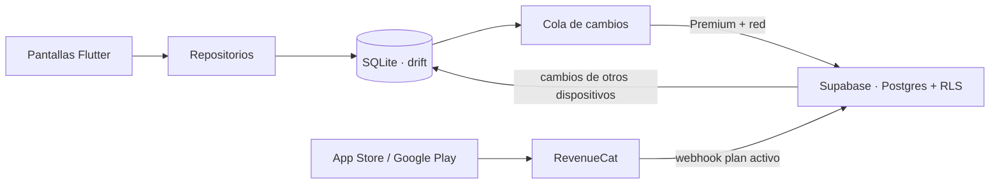

# FutData · Arquitectura y modelo de producto

Documento base de decisiones. Las pantallas propuestas están en `design/propuestas.html` y el prototipo interactivo en `design/prototipo.html`.

**Decisión de diseño:** dirección **B · Cancha**, solo tema claro (sin modo oscuro). La variante B+ (B con la densidad de A y las tarjetas para compartir de C) queda documentada como respaldo.

## 1. Producto

App móvil (Android + iOS, Flutter) para que un equipo registre su historia:
partidos con marcador, goleadores, tarjetas, alineaciones, sede y rival; calendario
y horarios; convocatorias; y análisis que convierten ese historial en decisiones.

Referencias de las que tomamos ideas:

| App | Qué tomamos |
|---|---|
| FotMob | Detalle de partido: línea de tiempo + barras de estadísticas enfrentadas |
| SofaScore | Momentum, calificación por jugador, mapa de tiros |
| OneFootball | Inicio limpio con el próximo partido como protagonista |
| Spond / TeamSnap | Convocatorias (voy / no voy), recordatorios, sede con mapa |
| Strava | Progreso personal, rachas y récords como motivo para pagar |
| Apple Sports | Tipografía grande y marcador sin ruido |

## 2. Planes

| | Gratis | Premium ($59 MXN/mes · $499/año) | Club (fase 2, $199/mes) |
|---|---|---|---|
| Almacenamiento | Solo local (SQLite) + respaldo manual | Nube + multi-dispositivo | Igual que Premium |
| Equipos | 1 | Ilimitados | Varias categorías |
| Colaboradores | — | Cuerpo técnico / capitán | Hasta 5 cuentas Premium |
| Calendario, sedes, rivales, eventos | ✔ | ✔ | ✔ |
| Estadísticas básicas (tabla, forma, goleadores, cara a cara) | ✔ | ✔ | ✔ |
| Análisis medio-avanzados | — | ✔ | ✔ |
| Sync con Google/Apple Calendar | — | ✔ | ✔ |
| Exportar PDF/CSV, tarjetas para redes | — | ✔ | ✔ |
| Anuncios | Banner discreto | No | No |

Cobro con suscripciones nativas de App Store / Google Play (obligatorio para bienes digitales)
gestionadas con RevenueCat (`purchases_flutter`). Prueba gratis de 7 días.

## 3. Análisis

| Análisis | Plan | Dónde se calcula |
|---|---|---|
| Tabla, forma, racha | Gratis | Vista SQL `v_resumen_temporada`, consulta `forma_ultimos_5` |
| Goleadores y asistencias | Gratis | Vista `v_goleadores` |
| Cara a cara | Gratis | `cara_a_cara` |
| Goles por franja de 15' | Premium | `goles_por_franja` |
| Rendimiento por contexto (local/visita, superficie, día/noche, sede) | Premium | `rendimiento_contexto` + Dart para hora local |
| Minutos y goles por 90' | Premium | `por_90` |
| Con / sin jugador, parejas | Premium | `con_sin_jugador` |
| Pronóstico del próximo partido (Poisson + Elo) | Premium | `insumos_pronostico` + Dart |
| Momentum, mapa de tiros, xG estimado | Premium | Eventos `TIRO` con `pos_x/pos_y` + modelo xG simple por zona |
| Disciplina y asistencia | Premium | `eventos` (tarjetas) + `convocatorias` |

Todas las consultas están en `db/consultas_analisis.sql` y se prueban con `python3 db/test_schema.py`.

## 4. Datos

### Local (todos los usuarios)
- **SQLite** con `drift`: consultas tipadas, migraciones versionadas, streams reactivos.
- Esquema en `db/schema.sql`. Tablas: `equipos` (propio y rivales), `jugadores`,
  `competiciones`, `temporadas`, `sedes`, `partidos`, `alineaciones`, `eventos`,
  `estadisticas_partido`, `convocatorias`, `cola_sync`, `meta_sync`, `preferencias`.
- IDs UUID v7 generados en el dispositivo; fechas ISO-8601 UTC + `zona_horaria`.
- Columnas de sincronización en cada tabla: `creado_en`, `actualizado_en`, `eliminado_en`, `version`.

### Nube (Premium)
- **Supabase** (Postgres + Auth + Storage + RLS). Mismo modelo relacional que SQLite,
  así los análisis se escriben en SQL en ambos lados.
- RLS por `equipo_id` con tabla `miembros_equipo(usuario_id, equipo_id, rol)`.
- Firebase evaluado y descartado como principal: Firestore no es relacional y los
  análisis por agregación serían más caros y complejos.

### Sincronización (offline-first)
1. Toda escritura va a SQLite y, si el plan es Premium, se agrega a `cola_sync`.
2. Con red: se suben los cambios en lotes (UPSERT/DELETE) en orden de `seq`.
3. Pull: se piden filas con `actualizado_en > meta_sync.ultimo_pull` por tabla.
4. Conflictos: gana la última escritura por fila (comparando `version` y `actualizado_en`).
   Los eventos de partido rara vez se editan por dos personas a la vez; si llega a pasar
   se puede subir a merge por campo más adelante.
5. Borrados siempre suaves (`eliminado_en`) para que se propaguen.



## 4b. Roles y permisos (borrador para validar)

Cada persona entra con su cuenta y un rol dentro del equipo (`miembros_equipo(usuario_id, equipo_id, rol, jugador_id)`).
El rol `padre` se vincula a uno o más jugadores (sus hijos) y el rol `jugador` a su propio registro.
En la nube se aplica con Row Level Security; en la app se ocultan las pantallas y acciones que el rol no puede usar.

| Permiso | Entrenador | Cuerpo técnico | Jugador | Padre/tutor | Por qué |
|---|:-:|:-:|:-:|:-:|---|
| Ver calendario, horarios y sedes | ✓ | ✓ | ✓ | ✓ | Todos necesitan saber cuándo y dónde; los padres llevan a los jugadores |
| Ver resultados, goles y tarjetas | ✓ | ✓ | ✓ | ✓ | Ya es información pública en la cancha y la liga |
| Ver récord y forma del equipo | ✓ | ✓ | ✓ | ✓ | Resultado colectivo, no señala a nadie |
| Responder su propia asistencia | — | — | ✓ | ✓ (por su hijo) | Cada quien confirma por sí mismo; el tutor responde por el menor |
| Ver sus propias estadísticas | — | — | ✓ | ✓ (de su hijo) | Derecho a consultar su propio progreso |
| Ver la alineación publicada | ✓ | ✓ | ✓ | ✓ | Solo cuando se publica, para no crear expectativas con borradores |
| Ver plantel completo (nombre, dorsal, posición) | ✓ | ✓ | ✓ | — | Protege datos de otros menores; el padre solo ve a su hijo |
| Ver tabla de goleadores | ✓ | ✓ | ✓ | — | Motiva al plantel; se evita comparar niños ante padres |
| Ver y cambiar la convocatoria de todos | ✓ | ✓ | — | — | Planeación del partido; nadie cambia la respuesta de otro |
| Armar y publicar la alineación | ✓ | ✓ | — | — | Decisión técnica |
| Registrar resultados, eventos y estadísticas | ✓ | ✓ | — | — | Pocos autorizados evitan marcadores contradictorios |
| Programar partidos; editar rivales, sedes y plantel | ✓ | ✓ | — | — | Logística que afecta a todos |
| Análisis comparativos y Premium | ✓ | ✓ | — | — | Para decidir; mostrarlos puede causar conflictos |
| Eliminar partidos, jugadores, rivales y sedes | ✓ | — | — | — | Irreversible, borra historial |
| Editar equipo (nombre, escudo) y pagar el plan | ✓ | — | — | — | Es la cuenta que se paga |

Teléfonos, fechas de nacimiento y contactos de jugadores solo los ve el cuerpo técnico.

## 5. Stack Flutter

| Capa | Paquete |
|---|---|
| Estado / DI | `flutter_riverpod` |
| Navegación | `go_router` |
| Base local | `drift`, `sqlite3_flutter_libs` |
| Nube | `supabase_flutter` |
| Pagos | `purchases_flutter` |
| Gráficas | `fl_chart` |
| Mapas | `flutter_map` o `google_maps_flutter`, `url_launcher` para "Cómo llegar" |
| Notificaciones | `flutter_local_notifications` |
| Calendario | `table_calendar`, `add_2_calendar` |

Estructura propuesta (por funcionalidad):

```
lib/
  app/            tema, router, arranque
  core/           db (drift), sync, pagos, utilidades
  features/
    inicio/
    partidos/     registrar, detalle, eventos, alineación
    calendario/
    sedes/
    equipo/       plantel, rivales
    analisis/     gratuitos y premium
    cuenta/       login, plan, ajustes
```

## 6. Roadmap

1. ~~Elegir dirección de diseño~~ → B · Cancha, tema claro. Validar flujos con el prototipo.
2. Proyecto Flutter + tema + base drift desde `db/schema.sql`.
3. MVP gratuito: equipos, rivales, sedes, calendario, registrar partido/eventos, estadísticas básicas.
4. Premium: cuentas, Supabase, sincronización, RevenueCat, primeros análisis.
5. Beta con 2–3 equipos de una liga local.
